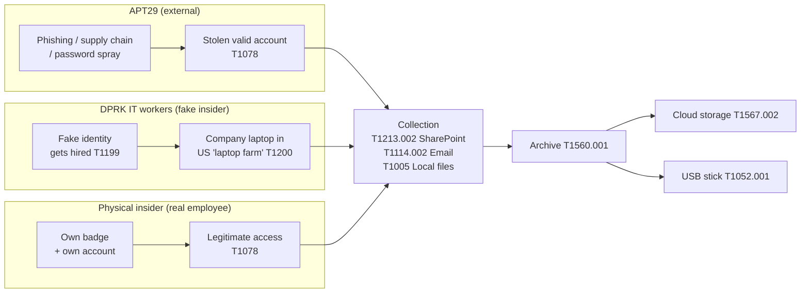
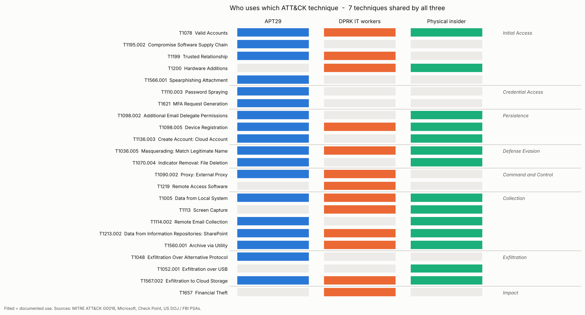
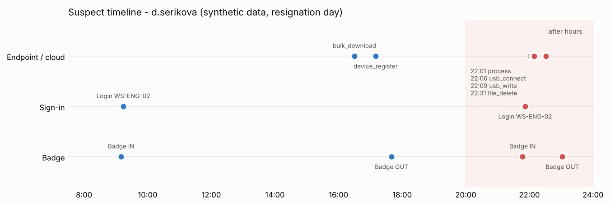

# Week 10 — Learning APT Techniques

**Project:** Physical Insider Threat · **Course:** Introduction to Threat Hunting (Syllabus 2026-2027, section 3.3)

**Week 10 tasks from the syllabus**

1. Analyze the TTPs of **APT29** or APT41.
2. Map the observed techniques to the **MITRE ATT&CK** framework.

**How we applied it to our topic**

We chose **APT29** and asked one question: *which APT techniques look the same as an insider's actions, and can our insider data (badge logs + IT logs) catch them?* To connect the "APT" and "physical insider" worlds we also added a second actor — **North Korean fake IT workers**, a state-backed operation that works *as* insiders and uses physical "laptop farms".

---

## 1. Why APT29 and not APT41

| Criterion | APT29 | APT41 |
|---|---|---|
| Main goal | Espionage (long, quiet access) | Espionage **and** financial crime |
| Key technique | Living off **valid accounts** and cloud identities | Exploiting public apps, malware |
| Supply chain | SolarWinds Orion (2020) — links to our Week 2 supply-chain case | Software supply chain too |
| Closeness to insider behaviour | **High** — once inside, APT29 behaves like a legitimate user | Lower — noisier malware activity |

APT29 is the better fit: after initial access it uses real accounts, real mailboxes and real SharePoint — exactly what a malicious employee does. So detections built for insiders also catch APT29, and vice versa.

## 2. APT29 profile

| Field | Value |
|---|---|
| ATT&CK ID | **G0016** |
| Aliases | Midnight Blizzard, Cozy Bear, NOBELIUM, The Dukes, UNC2452 |
| Attribution | Russian Foreign Intelligence Service (SVR) |
| Targets | Governments, diplomats, think tanks, IT and cloud providers |
| Motivation | Strategic intelligence collection |
| Style | Patient, stealthy, identity- and cloud-focused |

### Key campaigns and their TTPs

| Year | Campaign | What happened | Main ATT&CK techniques |
|---|---|---|---|
| 2020 | **SolarWinds** | Orion software updates were trojanized (SUNBURST) and shipped to ~18,000 customers; selected victims got a second stage | T1195.002, T1036.005, T1606.002 (Golden SAML), T1114.002, T1560.001 |
| 2024 | **Microsoft corporate breach** | Password spray against a legacy test tenant without MFA, then OAuth app abuse to read emails of senior leadership | T1110.003, T1078.004, T1098.001, T1114.002 |
| 2024 | **Signed RDP files** | Spear-phishing with signed `.rdp` attachments sent to thousands of users in 100+ organizations, using addresses from earlier compromises | T1566.001, T1021.001, T1199 |
| 2025 | **Diplomatic "wine-tasting" lures** | Fake invitations to European diplomats delivering the GRAPELOADER / WINELOADER malware | T1566.002, T1574 (DLL side-loading) |
| 2025 | **Watering hole (disrupted by Amazon)** | Compromised websites redirected visitors to fake pages to steal Microsoft 365 access via device-code authentication | T1189, T1528, T1550.001 |

**Pattern:** APT29 almost always ends up in the same place — **valid accounts → email & document stores → archive → exfiltration**. That is also the path of a malicious insider.

## 3. Bridge to our topic: APT ↔ insider



Three very different actors **converge on the same techniques** once they have access. That is the key finding of this week: we do not need to know *who* the attacker is to hunt the shared middle part of the chain.

### Why DPRK IT workers matter for a *physical* insider project

North Korean operatives get hired as remote developers with stolen identities. The company ships a laptop to a "US address" — in reality a **laptop farm** run by a local facilitator, where the laptop is connected to a KVM-over-IP device so the worker can control it from abroad.

- June 2025: the US DOJ searched 21 suspected laptop farms in 14 states and seized ~137 laptops.
- January 2025: the FBI warned that discovered workers steal source code and **extort** employers.
- October 2026: the FBI and DOJ charged 14 people, raided 40+ suspected laptop farms in Texas and seized ~187 devices.

This is a **physical** insider problem (where the hardware really is, which device is plugged in) caused by a **state-backed APT-like** actor — exactly between our two topics.

## 4. ATT&CK mapping and overlap

Full mapping: [`ttp_mapping.csv`](ttp_mapping.csv) — 23 techniques, each with an APT29 example, the insider equivalent, and **which of our log sources sees it**.



**7 techniques are used by all three actors:** T1078 Valid Accounts, T1098.005 Device Registration, T1036.005 Masquerading, T1005 Data from Local System, T1213.002 SharePoint, T1560.001 Archive via Utility, T1567.002 Exfiltration to Cloud Storage. These are our **hunt priorities**.

### ATT&CK Navigator layer

[`apt29_vs_insider_layer.json`](apt29_vs_insider_layer.json) — open <https://mitre-attack.github.io/attack-navigator/> → *Open Existing Layer* → *Upload from local*. Darker blue = more actors use the technique; each cell has a comment with the APT29 example, insider equivalent and log source.

## 5. Hunting: from TTPs to hypotheses

| # | Hypothesis | Techniques | Data we join |
|---|---|---|---|
| H1 | Remote login while badge shows the user **inside** = shared/stolen credentials | T1078 | Badge + VPN/sign-in |
| H2 | Office workstation login **without badge entry** = tailgating or shared account | T1078 | Badge + logon events |
| H3 | **After-hours** badge entry + archiving + USB write = physical exfiltration | T1560.001, T1052.001, T1070.004 | Badge + EDR |
| H4 | Employee who gave **resignation notice** bulk-downloads files and enrolls a personal device | T1213.002, T1098.005 | HR + SharePoint + IdP |
| H5 | Several "different" remote hires on **one home IP** + KVM / AnyDesk = laptop farm | T1200, T1219, T1090.002 | Sign-in + EDR |

### Practical demo (Python, synthetic data)

[`hunt_insider.py`](hunt_insider.py) creates small fake logs (`badge.csv`, `signin.csv`, `endpoint.csv`, `employees.csv`), links them with the Week 3 chain **Badge ID → Employee ID → Account → Activity**, and runs H1–H5.

Result ([`findings.csv`](findings.csv)):

| Hunt | Account | Severity |
|---|---|---|
| H1 Badge-IN + remote VPN | a.nurlanov | High |
| H2 Office login, no badge | s.kim | Medium |
| H3 After-hours archive → USB | d.serikova | **Critical** |
| H4 Leaver data grab | d.serikova | High |
| H5 Laptop-farm pattern | j.miller, r.chen | High |

The top suspect hits two hunts on the same day. Neither the badge log nor the EDR log alone looks critical — together they tell the whole story:



Production versions of the same hunts in KQL (Microsoft Sentinel / Defender XDR): [`hunting_queries.md`](hunting_queries.md).

## 6. Defensive recommendations

| Technique(s) | ATT&CK mitigation | Practical control |
|---|---|---|
| T1078, T1110.003, T1621 | M1032 Multi-factor Authentication | Phishing-resistant MFA, number matching; no legacy tenants without MFA (lesson from Microsoft 2024) |
| T1098.005, T1136.003 | M1018 User Account Management | Alert on new device registration; offboarding checklist disables devices same day |
| T1200, T1052.001 | M1034 Limit Hardware Installation | Block unknown USB storage; alert on KVM / HID devices |
| T1567.002, T1213.002 | M1057 Data Loss Prevention | DLP + CASB on personal cloud storage; bulk-download alerts |
| T1199 (fake hires) | M1017 User Training | HR: live video interview, document checks, laptop only to verified address |
| All | Correlation | Ingest **badge logs into the SIEM** — physical and digital data together |

## 7. Conclusion

- APT29 is an "external insider": after access it acts like a normal user, so **identity and data-access hunting** beats malware-signature hunting.
- APT29, DPRK fake IT workers and a physical insider share **7 ATT&CK techniques** in the collection and exfiltration phases.
- **Physical data (badge logs, device-plug events, shipping addresses) adds context** that pure IT logs miss — this is the main value of our project's insider angle.
- One log source is not enough; the critical finding appeared only after joining badge + EDR + cloud + HR data.

## 8. How to reproduce

```bash
pip install pandas matplotlib
python build_layer.py     # -> Navigator layer + overlap matrix
python hunt_insider.py    # -> sample logs, findings.csv, timeline
```

## Week 10 files

| File | What it is |
|---|---|
| `week 10.md` | This report |
| `ttp_mapping.csv` | 23 techniques × 3 actors |
| `apt29_vs_insider_layer.json` | ATT&CK Navigator layer |
| `build_layer.py` | Builds the layer and the overlap matrix |
| `hunt_insider.py` | Synthetic logs + hunts H1–H5 |
| `employees.csv`, `badge.csv`, `signin.csv`, `endpoint.csv` | Synthetic sample logs |
| `findings.csv` | Hunt results |
| `hunting_queries.md` | KQL hunts H1–H6 |
| `ttp_overlap_matrix.png`, `suspect_timeline.png` | Images |

## Sources

- MITRE ATT&CK — APT29 (G0016): <https://attack.mitre.org/groups/G0016/>
- Microsoft — Midnight Blizzard: Guidance for responders on nation-state attack (Jan 2024): <https://www.microsoft.com/en-us/security/blog/2024/01/25/midnight-blizzard-guidance-for-responders-on-nation-state-attack/>
- Security Affairs — Midnight Blizzard RDP spear-phishing campaign (Oct 2024): <https://securityaffairs.com/170398/apt/midnight-blizzard-apt-targeted-100-organizations.html>
- Check Point Research — APT29 phishing against European diplomacy (2025): <https://blog.checkpoint.com/research/unmasking-apt29-the-sophisticated-phishing-campaign-targeting-european-diplomacy/>
- BleepingComputer — Amazon disrupts APT29 watering hole (2025): <https://www.bleepingcomputer.com/news/security/amazon-disrupts-russian-apt29-hackers-targeting-microsoft-365/>
- TechCrunch — US takes down North Korean remote IT workers operation (Jun 2025): <https://techcrunch.com/2025/06/30/us-government-takes-down-major-north-korean-remote-it-workers-operation>
- FBI IC3 PSA — North Korean IT workers conducting data extortion (Jan 2025): <https://www.ic3.gov/PSA/2025/PSA250123>
- US DOJ — Coordinated actions against North Korean remote IT worker schemes (Oct 2026): <https://justice.gov/opa/pr/justice-department-announces-coordinated-actions-combat-north-korean-remote-it-worker>
- Syllabus recommended reading: Mandiant APT1 Report; CrowdStrike Global Threat Report

## AI Usage Statement

In line with the course policy on generative AI (Syllabus, section 9), we disclose that **Claude (Anthropic, model Claude Opus 5.5)** was used in this week's work.

| Part of the work | How AI was used |
|---|---|
| Report text (`README.md`) | Drafting the structure and text of the APT29 analysis |
| ATT&CK mapping (`ttp_mapping.csv`) | Proposing techniques and insider equivalents |
| Scripts (`build_layer.py`, `hunt_insider.py`) | Generating the code, synthetic logs and charts |
| KQL queries (`hunting_queries.md`) | Drafting the hunting queries |
| Research | Web search for recent APT29 and DPRK IT worker cases |

**What the team did:** chose the topic and the actor, checked technique IDs against attack.mitre.org, opened every source link, ran the scripts and reviewed the results, and is responsible for the final content and its defense.

All facts are taken from the sources listed above, not from the AI itself. The logs in `badge.csv`, `signin.csv`, `endpoint.csv`, `employees.csv` are synthetic and do not describe real people or companies.
